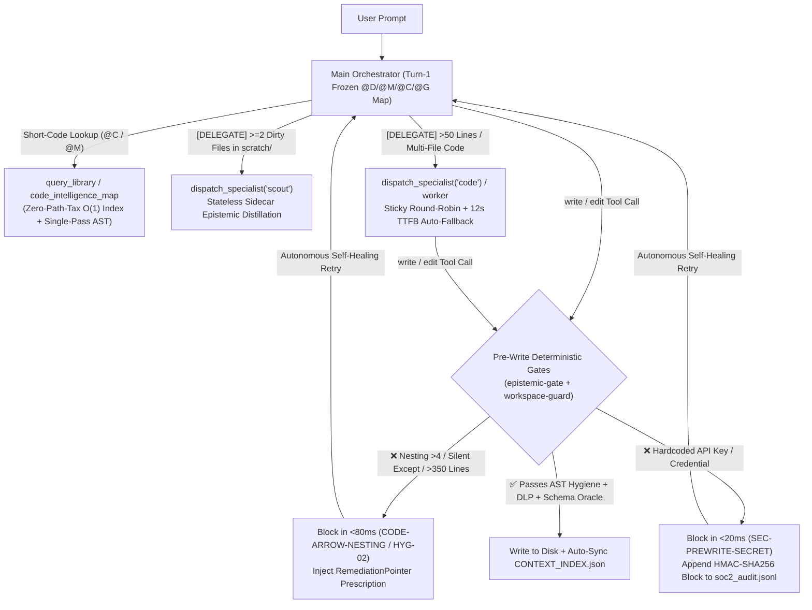

# ⚓ NetArk (`N.E.T.A.R.K.`) — Clean-Room V1 Agentic Engineering Kernel

> **Language / 語言**: **English** | [繁體中文](README.zh-TW.md)

**N**etwork-shielded, **E**nforced-**T**emplate **A**rchival & **R**ule-indexed **K**ernel (`NetArk`) is a portable, multi-host Agentic Engineering & Epistemic Governance Engine for **Pi Coding Agent**, **Google Antigravity (AGY)**, and **Claude Code**.

---

## 🌟 Core Architecture Pillars

1. **Two-Layer Portable Brain (`.netark/` + `memory/`)**
   - **Execution Brain (`.netark/`)**: Portable extensions, subagent roles (`scout`, `architect`, `challenger`, `worker`, `auditor`), model routing (`role-models.json`), and zero-trust workspace guardrails.
   - **Governed Memory Graph (`memory/`)**: Clean 5-node starting foundation (`000_SOUL.md`, `100_ARCH_RULES.md`, `200_DECISIONS.md`, `LEDGER.md`, `HANDOVER.md`) enforced by an external deterministic Oracle (`schemas/schema_validator.py`).

2. **Turn-1 Frozen `@D/@M/@C/@G` Codebook Topology Map (~94% Token Compression)**
   - Compiled automatically by `scripts/auto_update_map.py` into `memory/index/CONTEXT_INDEX.json`.
   - Injects a compact directory dictionary (`@D`), memory node dictionary (`@M`), script coordinate dictionary (`@C`), and 3-layer Dashboard topology graph (`@G`: `[DAG]` causal links, `[SYN]` governance synapses, `[AST]` code imports) at Turn 1 for 100% Prefix KV-Cache hit rates.
   - Scales automatically across **L1-Full** ($\le 150$ scripts), **L2-Cluster** ($151\sim1,500$ scripts), and **L3-ActiveCone** ($> 1,500$ scripts).

3. **3-Tier Local Security Guard & Vaultless DLP (`G-01` ~ `G-05` Hardened)**
   - **Tier 0 (`schemas/netark_guard_core.py`)**: Three-stage structural AST (`shlex` quote coalescing, subshell unwrapping, inline `python -c` `ast.parse`), workspace confinement, control-plane protection (`.netark/`, `.agents/`, `.claude/`, `schemas/`), `*vault*.json` & `.env*` hard block (`G-01`), and pre-write secret lint (`SEC-PREWRITE-SECRET`, `G-02`/`G-04`).
   - **Tier 1 (`scripts/netark_guard_daemon.py`)**: Local ONNX CPU classifier (`Llama-Prompt-Guard-2-22M`) with zero-VRAM heuristic fallback and developer Fast-Path bypass.
   - **Tier 2**: Pluggable OpenAI-compatible semantic guardian slot with HMAC-SHA256 chained SOC2 audit logging (`.netark/audit/soc2_audit.jsonl`).

4. **Standalone PM Control Center (`dashboard/` — V1.1)**
   - Zero-dependency HTTP/HTTPS dual-protocol visual war room (`python3 dashboard/backend/server.py 8765`) featuring Structure Tree, 4-Lane Causal Graph View, Ledger & Handover Kanban, and Code Line-Budget Health Monitor.

---

## 🚀 Quick Start

### 1. Bootstrap Current or External Workspace (`netark_init.py`)

```bash
# Initialize all host adapters (Pi + AGY + Claude) with Traditional Chinese memory templates
python3 scripts/netark_init.py --target all --lang zh-TW --cwd /path/to/your-project

# Or initialize with English memory templates
python3 scripts/netark_init.py --target all --lang en --cwd /path/to/your-project

# Non-destructive in-place update of an existing workspace (preserves memory/ & auth.json)
python3 scripts/netark_init.py --target all --cwd /path/to/your-project --update
```

### 2. Launch with Pi Coding Agent

```bash
export PI_CODING_AGENT_DIR="$(pwd)/.netark"
cp .netark/auth.example.json .netark/auth.json
# Configure your API keys via `.netark/auth.json` or interactive `/mode` inside Pi
pi
```

### 3. Launch Standalone Visual Dashboard

```bash
npm run dashboard
# Or directly via Python:
python3 dashboard/backend/server.py 8765
```

---

## 🧪 Deterministic Verification Suite

Run all 5 built-in verification suites before committing:

```bash
# 1. Tier 0 AST & G-01..G-05 DLP Self-Test
python3 schemas/netark_guard_core.py --self-test

# 2. Multi-Host Daemon & Pre-Write Secret Lint Self-Test
python3 scripts/netark_guard_daemon.py --self-test

# 3. Codebook Map Compiler & Schema Oracle
python3 scripts/auto_update_map.py --print-codebook
python3 schemas/schema_validator.py --run-oracle

# 4. Dashboard Shards Contract Suite
python3 dashboard/tests/test_dashboard_shards.py

# 5. Full Harness & Enterprise Guard E2E Suites
python3 scripts/test_netark_harness.py
python3 scripts/test_netark_enterprise_guard.py
```

---

## 🛡️ Live Runtime Guard & Specialist Routing Showcase

NetArk enforces architectural and security invariants **deterministically at runtime** before any tool touches the disk, paired with `RemediationPointer` prescriptions so agents self-heal autonomously without human intervention.

### Architecture & Defense Lifecycle



### Live End-to-End Intercept & Self-Healing Trace

| Scenario | Trigger Action | Runtime Guard / Router Response | Latency | Autonomous Resolution |
| :--- | :--- | :--- | :--- | :--- |
| **1. Zero-Path-Tax Codebook & AST Lookup** | `query_library("100")`, `query_library("C1")`, `code_intelligence_map(unused_only=true)` | Resolves `@M` prefix `"100"` $\rightarrow$ `MEM-2026-0002` (`100.ARCH-RULES.v1`), `@C` short-code `"C1"` $\rightarrow$ `schemas/netark_guard_core.py (L1-399)` symbol table, and isolates unused imports across workspace scripts. | `~400 ms` | Zero exploratory `grep`/`find` calls; 100% Turn-1 KV-Cache preservation. |
| **2. Pre-Write AST Code Hygiene Gate** | `write("src/demo_hygiene.py")` with 7-level nested control flow + `except Exception: pass` | **Blocked before disk I/O**: `🛡️ [NetArk AST Code Hygiene Gate \| CODE-ARROW-NESTING]` flags depth `7 > 4` max allowed and prescribes Early-Return refactoring. | `79 ms` | Agent autonomously flattens control flow to Early-Return guard clauses (depth $\le 2$, named `except KeyError`) and passes on retry (`+7.7 s`). |
| **3. Specialist Dispatch + Multi-Model Auto-Fallback** | Prompt for ~70-line tiered order discount engine (`src/discount_engine.py`) | Orchestrator triggers `@G [DELEGATE]` rule (`>50` lines), expands prompt into a 7-point spec (`Decimal`, `Enum`, `30%` cap, `TypeError`/`ValueError` guards), and dispatches `specialist="code"`. Primary model hits 12s TTFB timeout $\rightarrow$ **Sticky Round-Robin automatically fails over** to backup model. | `12.0 s` failover | Backup specialist delivers production-grade `Decimal` implementation; passes AST gate on first write. |
| **4. Pre-Write Secret DLP + `scout` Sidecar Distillation** | `write("scratch/legacy_notes_a.md")` containing mock `sk-legacy-a-<REDACTED>` key, followed by multi-file synthesis | **Blocked before disk I/O**: `🛡️ [NetArk Guard \| SEC-PREWRITE-SECRET]` intercepts `OPENAI_KEY` pattern, writes HMAC-SHA256 chained `BLOCK` entry to `.netark/audit/soc2_audit.jsonl`, and prescribes env-var substitution. | `18 ms` | Agent replaces plaintext key with `LEGACY_A_API_KEY` env-var reference, then dispatches `specialist="scout"` to distill `[FACT]` / `[INFERRED]` conflict tables. |

<details>
<summary><b>🔍 View Real Pre-Write AST Block & Autonomous Self-Healing Transcript (Test 2)</b></summary>

```python
# 1. Agent's initial write("src/demo_hygiene.py") attempt (Blocked in 79ms — Never touches disk):
def process_data(data):
    result = None
    if data is not None:
        if isinstance(data, dict):
            if "items" in data:
                if len(data["items"]) > 0:
                    for item in data["items"]:
                        if item.get("active"):
                            try:
                                result = item["value"]
                            except Exception:
                                pass
    return result
```

```text
🛡️ [NetArk AST Code Hygiene Gate | CODE-ARROW-NESTING]
[P1 CODE-ARROW-NESTING] Function 'process_data' in 'src/demo_hygiene.py' reaches control-flow nesting depth 7 (> 4 max allowed, line 1). Flatten using Early-Return guard clauses (`if not cond: return/continue`) or extract a helper.
```

```python
# 2. Agent's autonomous self-healed retry 7.7s later (Nesting depth <= 2 — Passed & Written):
def process_data(data):
    if data is None or not isinstance(data, dict):
        return None
    items = data.get("items")
    if not items:
        return None
    for item in items:
        if not item.get("active"):
            continue
        try:
            return item["value"]
        except KeyError:
            continue
    return None
```
</details>

<details>
<summary><b>🔍 View Real Pre-Write DLP Block, Auto-Fallback Header & Specialist Code Output (Tests 3 & 4)</b></summary>

```text
🛡️ [NetArk Guard | SEC-PREWRITE-SECRET] 寫檔防呆攔截：偵測到嘗試將明文金鑰或憑證 (OPENAI_KEY) 直接寫入檔案 (scratch/legacy_notes_a.md)！
🔧 [RemediationPointer | 自癒處方籤]: 嚴禁將 API Key 硬編碼寫入源碼或設定檔！請將程式碼改寫為 `os.environ.get('KEY_NAME')` 或 `process.env.KEY_NAME`，並提示人類使用者自行於 `.env` 設定（嚴禁 Agent 讀寫 `.env`）。
```

```text
🤖 **[Specialist: code | Model: nvidia/nvidia/nemotron-3.5-lightning-30b-a3b]**
⚡ *[Auto-Fallback Triggered: nvidia/poolside/laguna-xs-2.1 (round 1/1): Request aborted [TTFB timeout (12s no first token)] -> Completed by nvidia/nvidia/nemotron-3.5-lightning-30b-a3b]*
```

```python
# Generated by 'code' specialist under Orchestrator's 7-point specification (src/discount_engine.py):
from enum import Enum
from decimal import Decimal
from typing import Optional

class VIP_Level(Enum):
    BRONZE = Decimal("0")
    SILVER = Decimal("5")
    GOLD = Decimal("10")
    PLATINUM = Decimal("15")

def calculate_final_price(
    amount: Decimal,
    vip_level: VIP_Level,
    coupon_discount: Optional[Decimal] = None,
) -> Decimal:
    if not isinstance(amount, Decimal):
        raise TypeError("amount must be a Decimal")
    if amount < 0:
        raise ValueError("amount must be non-negative")
    if coupon_discount is not None and not isinstance(coupon_discount, Decimal):
        raise TypeError("coupon_discount must be a Decimal or None")
    ...
```
</details>

---

## ⚖️ License

Dual-licensed under the **Prosperity Public License 3.0.0** ([LICENSE](LICENSE)) and the **NetArk Commercial License** ([COMMERCIAL-LICENSE.md](COMMERCIAL-LICENSE.md)). Contributions are governed by [CLA.md](CLA.md).
