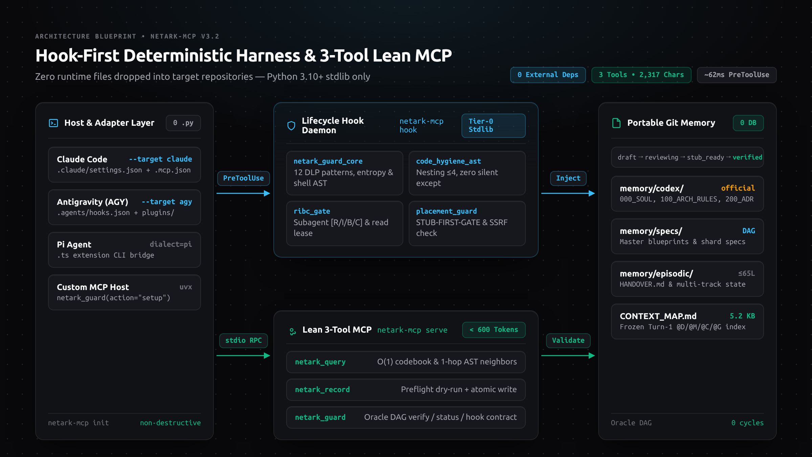
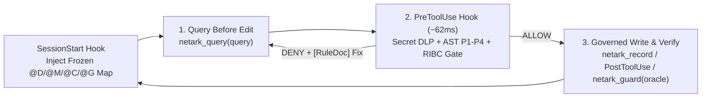
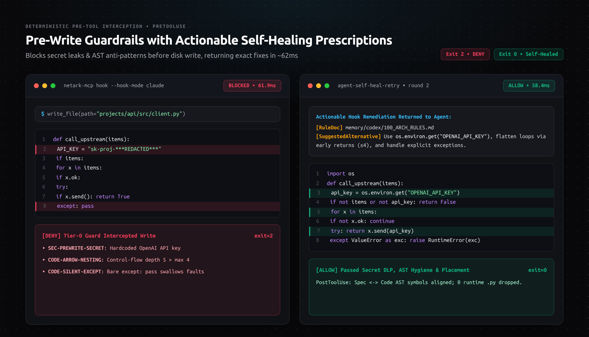
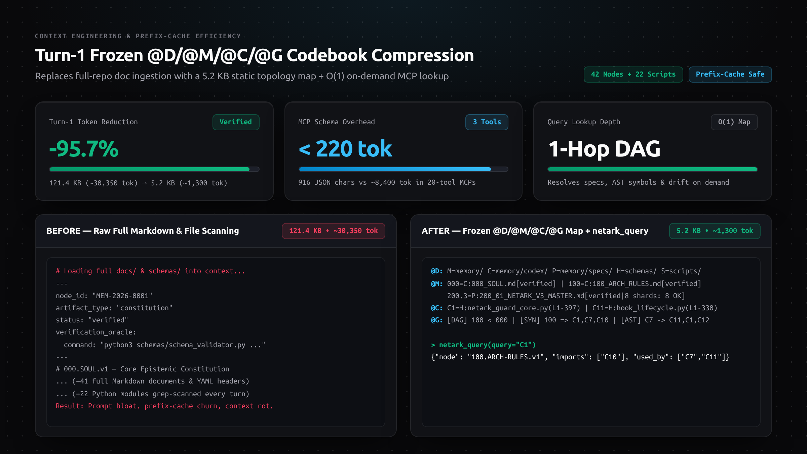
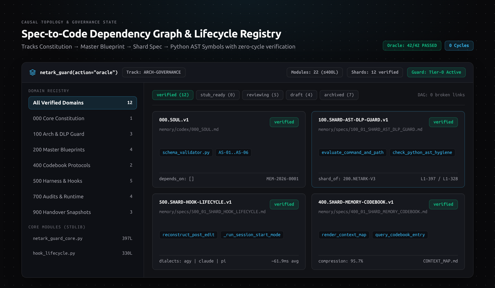

# NetArk (`netark-mcp`)

**Zero-Dependency Deterministic AI Coding Harness & Portable Markdown Governance MCP.**

[](https://github.com/joinblue/NetArk/actions/workflows/ci.yml)
[](https://www.python.org/downloads/)
[-brightgreen.svg)](pyproject.toml)
[](docs/QUICKSTART.md)
[](LICENSE)

**English** | [繁體中文](README.zh-TW.md)

NetArk gives AI coding agents (Claude Code, Google Antigravity, Pi Agent, and custom MCP hosts) **deterministic pre-write AST/secret guardrails** and a **Git-portable Markdown memory graph** — packaged as a single pure-stdlib Python CLI (`netark-mcp`) with **0 runtime files** dropped into your repository.

<p align="center">
  
</p>

> [!WARNING]
> **⚠️ For Developers & AI Coding Agents: Do NOT `git clone` this repository into your project!**
> - **NetArk (`netark-mcp`) is a global CLI & MCP server** designed to leave **0 `.py` runtime files** inside your target repository.
> - **For AI Agents (Claude Code / Google Antigravity / Cursor / Pi)**: Read the raw docs first via `curl -fsSL https://raw.githubusercontent.com/joinblue/NetArk/main/README.md`, then install globally and initialize in place:
>   ```bash
>   uv tool install netark-mcp
>   netark-mcp init --target agy --cwd /path/to/your-project   # or --target claude / memory
>   ```

---

## Key Engineering Benchmarks

| Metric | Value | Why It Matters |
| :--- | :--- | :--- |
| **MCP Context Footprint** | **`3 Tools (< 220 Tokens)`** | Keeps tool-schema overhead near zero (`netark_query`, `netark_record`, `netark_guard`). |
| **Runtime Dependencies** | **`0 External Packages`** | Pure Python 3.10+ standard library; no vector DB, Docker, or Node.js runtime required. |
| **Pre-Write Hook Latency** | **`~62ms` (`PreToolUse`)** | Deterministic AST nesting, silent-except, secret DLP, and shell inspection before disk writes. |
| **Turn-1 Context Compression** | **`95.7%` Token Saved** | Compresses multi-node specs & AST edges into a frozen `@D/@M/@C/@G` map (`5.2 KB`). |

---

## 30-Second Quickstart (`uv` / `uvx`)

Install `netark-mcp` once globally for full **Hooks + MCP**, or run `uvx` directly for **MCP-only**:

```bash
# 1. Install globally from PyPI (recommended for native-speed PreToolUse hooks)
uv tool install netark-mcp
# Or install directly from GitHub main:
# uv tool install git+https://github.com/joinblue/NetArk

# 2. Initialize your project (creates 0 .py files inside your repo)
cd /path/to/your-project
netark-mcp init --lang en --cwd .
```

<details>
<summary><b>Choose Your Host Setup (Default Memory / Claude Code / AGY / Pi Agent &amp; Custom Hosts)</b></summary>

- **Default — Zero Host Intrusion (`--target memory`)**:
  ```bash
  netark-mcp init --cwd .
  ```
  Creates/merges only `.mcp.json`, policy config, and starter `memory/` nodes without touching host rules or hook files.

- **Claude Code (`--target claude`)**:
  ```bash
  netark-mcp init --target claude --lang en --cwd .
  ```
  Non-destructively merges `.mcp.json`, `.claude/settings.json` (`SessionStart`, `PreToolUse`, `PostToolUse`, `Stop`), and starter `memory/` nodes.

- **Google Antigravity / AGY (`--target agy`)**:
  ```bash
  netark-mcp init --target agy --lang en --cwd .
  ```
  Wires `.agents/hooks.json`, `.agents/plugins/netark/mcp_config.json`, `.agents/enterprise-policy.json`, and starter `memory/` nodes.

- **Pi Agent / Custom MCP Hosts (`uvx` + Universal Hook Contract)**:
  ```json
  {
    "mcpServers": {
      "netark": {
        "command": "uvx",
        "args": ["netark-mcp", "serve", "--cwd", "."]
      }
    }
  }
  ```
  Then instruct your agent to call `netark_guard(action="setup")` (or inspect [docs/HOOK_CONTRACT.md](docs/HOOK_CONTRACT.md)) to wire the stdin/stdout hook bridge.

</details>

---

## How It Works (Hooks + 3-Tool Closed Loop)



### 1. Deterministic Pre-Write Guardrails (`~62ms`)
Stops hardcoded credentials (`SEC-PREWRITE-SECRET`), `.env` / vault reads (`SEC-CRED`), silent `except: pass` (`CODE-SILENT-EXCEPT`), deep arrow nesting (`CODE-ARROW-NESTING`), destructive shell subshells, and unguarded subagent dispatches — returning structured `[RuleDoc]` and `[SuggestedAlternative]` remediation so the agent fixes itself in one turn.

<p align="center">
  
</p>

*(Also available as an [animated terminal sequence](docs/assets/demo-prewrite-guard.gif), or regenerate locally with [`scripts/render_assets/`](scripts/render_assets/render_assets.py) / [`demo-prewrite-guard.tape`](scripts/render_assets/demo-prewrite-guard.tape).)*

### 2. Turn-1 `@D/@M/@C/@G` Context Compression (`95.7%` Saved)
Instead of flooding every prompt with raw Markdown specs and source files, `SessionStart` injects a frozen compact directory/node/script/dependency codebook (`5.2 KB`). Prefix caches remain intact while `netark_query` resolves exact 1-hop node summaries and AST neighbors on demand.

<p align="center">
  
</p>

### 3. Stub-First Governance Lifecycle & Spec ↔ Code Alignment
Tracks every change from `draft` ➔ `reviewing` ➔ `stub_ready` ➔ `verified` ➔ `archived`. `STUB-FIRST-GATE` and `SPEC-AST-SYNC-GATE` prevent agents from inventing modules without an approved spec or drifting from declared AST symbols.

<p align="center">
  
</p>

---

## 3 High-Cohesion MCP Tools

| Tool | Purpose | Key Inputs |
| :--- | :--- | :--- |
| **`netark_query`** | O(1) codebook lookup & 1-hop AST/DAG neighbor resolution | `query`, `project_id` *(optional)* |
| **`netark_record`** | Schema-validated memory authoring (`preflight` dry-run or atomic `write`) | `intent`, `title`, `body`, `mode` (`preflight` \| `write`), `affected_paths`, `parent_blueprint` |
| **`netark_guard`** | Policy health check, full-repo DAG oracle, handover audit, or Hook contract | `action` (`status` \| `oracle` \| `handover` \| `setup`) |

---

## How NetArk Compares to the Ecosystem

| Approach | External DB / Runtime | Pre-Write AST & Secret Hooks | Spec ↔ Code Drift & Stub Gate | Prefix-Cache Safe Turn-1 Map |
| :--- | :---: | :---: | :---: | :---: |
| **NetArk (`netark-mcp`)** | **None (Python 3.10+ Stdlib)** | **Yes (`~62ms` deterministic)** | **Yes (`STUB-FIRST` + `oracle`)** | **Yes (`@D/@M/@C/@G`, 95.7% saved)** |
| Raw `CLAUDE.md` / `AGENTS.md` | None | No (advisory prompt only) | No | Degrades as docs grow |
| Vector / Graph Memory MCP (`Mem0`, `Zep`) | Vector DB / Graph DB / LLM API | No | No | Dynamic retrieval can churn context |
| LSP Symbol MCP (`Serena`) | Language Servers | No | Symbol lookup only | No governance lifecycle |

---

## Documentation & Links

- **[Quickstart & Multi-Host Setup](docs/QUICKSTART.md)** — `uv` / `uvx` setup, `--target` modes, non-destructive merging, and uninstall.
- **[Universal Hook CLI Contract](docs/HOOK_CONTRACT.md)** — 5 lifecycle hooks, JSON stdin contract, and `agy` / `claude` / `pi` dialects.
- **[Security Guardrails & Remediation Reference](docs/SECURITY_GUARDRAILS.md)** — Immutable core rules, `enterprise-policy.json` schema, and guard code guide.
- **[Contributing](CONTRIBUTING.md)**, **[CLA](CLA.md)** & **[Security Policy](SECURITY.md)** — Solo-maintained contribution boundaries, CLA, and zero-dependency guidelines.
- *Looking for the early TypeScript Pi Coding Agent prototype?* See [NetArk-preview](https://github.com/joinblue/NetArk-preview).

---

## Community & Support

- **Questions, Ideas & Showcases**: [GitHub Discussions](https://github.com/joinblue/NetArk/discussions)
- **Bug Reports**: [GitHub Issues](https://github.com/joinblue/NetArk/issues)
- **Security Vulnerabilities**: [SECURITY.md](SECURITY.md) (Private Vulnerability Reporting)
- **Architecture Consulting & Custom Integration**: `joinblue42+netark@gmail.com`

---

Licensed under the [Apache License 2.0](LICENSE).
