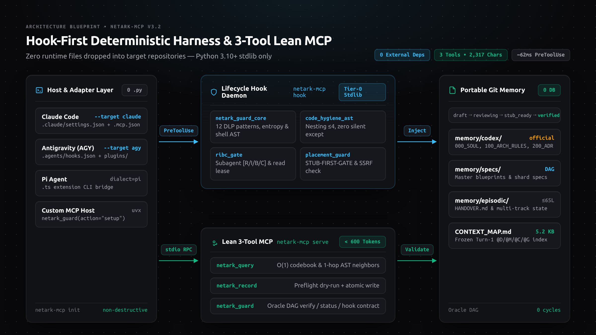
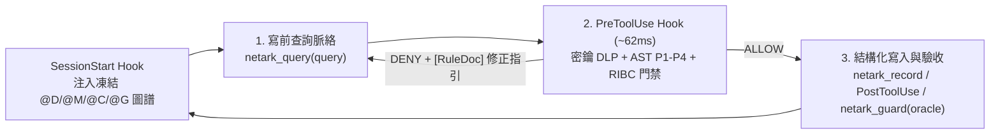
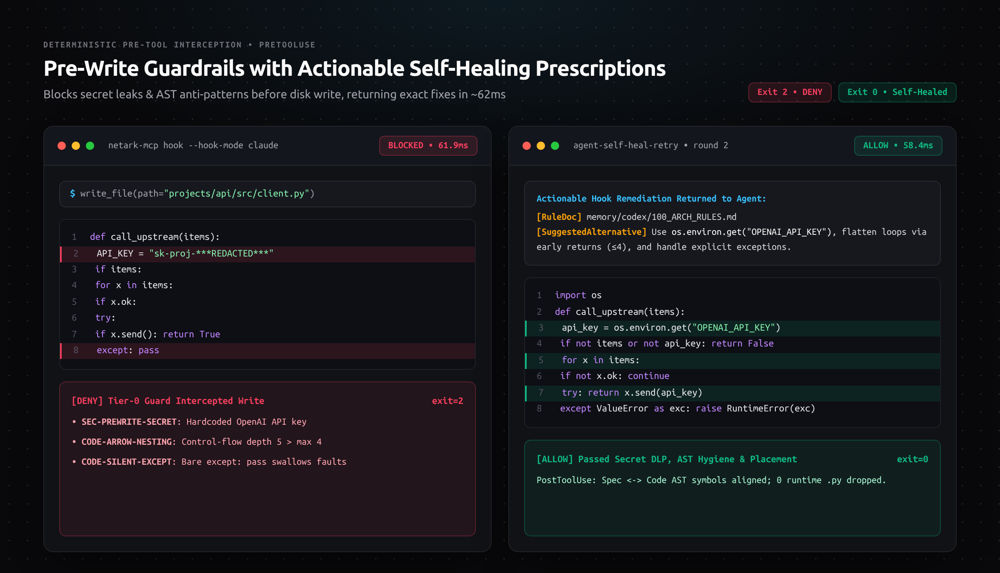
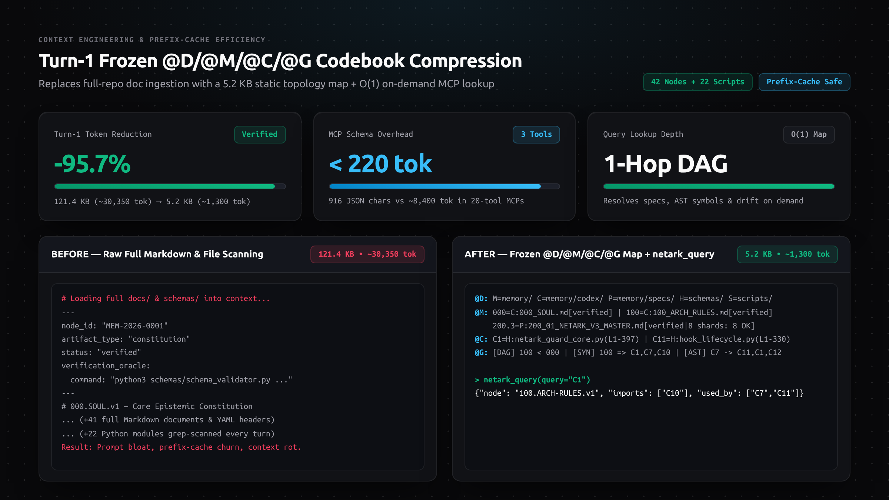
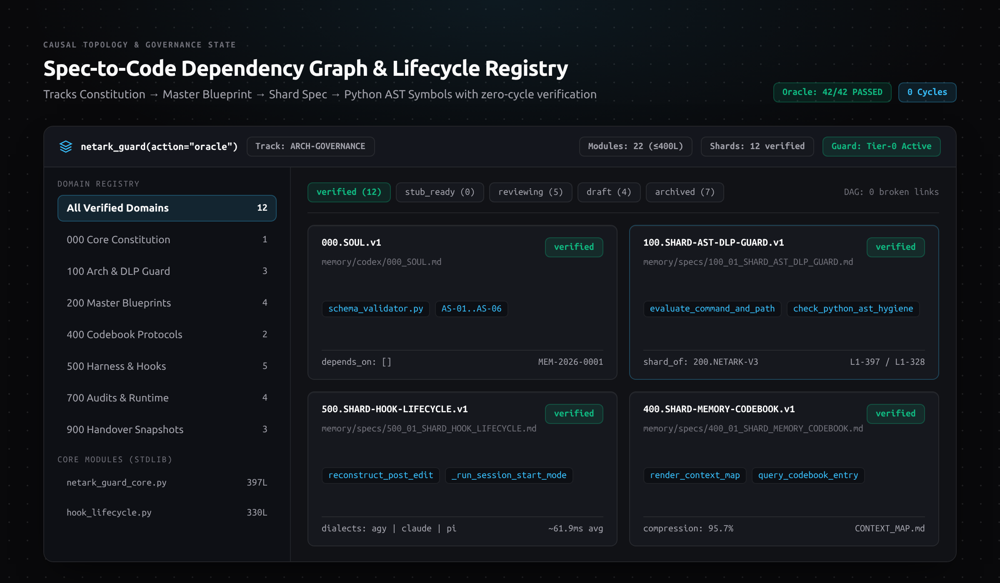

# NetArk (`netark-mcp`)

**零外部依賴的確定性 AI 寫碼治理引擎與 Git 可攜式 Markdown 記憶 MCP。**

[](https://github.com/joinblue/NetArk/actions/workflows/ci.yml)
[](https://www.python.org/downloads/)
[-brightgreen.svg)](pyproject.toml)
[](docs/QUICKSTART.md)
[](LICENSE)

[English](README.md) | **繁體中文**

NetArk 為 AI 寫碼助手（Claude Code、Google Antigravity、Pi Agent 與自訂 MCP 宿主）提供**毫秒級寫前 AST／密鑰攔截護欄**與 **Git 原生可攜式記憶圖譜**，以純 Python 標準庫 CLI（`netark-mcp`）封裝交付，不在目標業務專案留下任何 `.py` 執行期腳本。

<p align="center">
  
</p>

---

## 核心工程實測指標

| 指標項目 | 實測數據 | 工程效益 |
| :--- | :--- | :--- |
| **MCP Schema 佔用** | **`3 工具 (< 220 Tokens)`** | 只暴露 `netark_query`、`netark_record`、`netark_guard`，極大化保留工作上下文。 |
| **外部依賴套件** | **`0 外部依賴`** | 100% Python 3.10+ 標準庫實作；不需向量資料庫、Docker 或 Node.js 執行環境。 |
| **寫前 Hook 延遲** | **`~62ms` (`PreToolUse`)** | 檔案寫入或命令執行前完成 AST 巢狀深度、靜默例外、憑證 DLP 與落點掃描。 |
| **Turn-1 上下文壓縮** | **`95.7%` Token 節省** | 開局自動將所有記憶節點、模組與 DAG 邊壓縮為凍結 `@D/@M/@C/@G` 代號圖譜（`5.2 KB`）。 |

---

## 30 秒快速上手（`uv` / `uvx`）

使用 `uv` 全域安裝即可同時啟用 **原生速度 Hooks + MCP**；若只需單純掛載 MCP 亦可直接以 `uvx` 啟動：

```bash
# 1. 從 PyPI 安裝 CLI（推薦：提供原生速度的 PreToolUse Hook 與 stdio MCP）
uv tool install netark-mcp
# 或從 GitHub 最新主線安裝：
# uv tool install git+https://github.com/joinblue/NetArk

# 2. 初始化目標專案（預設 --target memory，不在專案留下任何 .py 檔）
cd /path/to/your-project
netark-mcp init --lang zh-TW --cwd .
```

<details>
<summary><b>選擇宿主整合模式（預設純記憶 / Claude Code / AGY / Pi Agent 與通用宿主）</b></summary>

- **預設模式 — 零宿主目錄侵入（`--target memory`）**：
  ```bash
  netark-mcp init --lang zh-TW --cwd .
  ```
  僅建立或非破壞性合併 `.mcp.json`、政策設定與 5 個初始 `memory/` 節點，不更動任何宿主專屬目錄或根目錄 `AGENTS.md`/`CLAUDE.md`。

- **Claude Code（`--target claude`）**：
  ```bash
  netark-mcp init --target claude --lang zh-TW --cwd .
  ```
  非破壞性合併 `.mcp.json`、`.claude/settings.json`（`SessionStart`、`PreToolUse`、`PostToolUse`、`Stop`）與 `.claude/commands/`。

- **Google Antigravity / AGY（`--target agy`）**：
  ```bash
  netark-mcp init --target agy --lang zh-TW --cwd .
  ```
  自動接線 `.agents/hooks.json`、`.agents/plugins/netark/mcp_config.json`、`.agents/enterprise-policy.json`、`.agents/skills/` 與 `.agents/workflows/`。

- **Pi Agent / 自訂 MCP 宿主（`uvx` ＋ 通用 Hook 契約）**：
  ```json
  {
    "mcpServers": {
      "netark": {
        "command": "uvx",
        "args": ["netark-mcp", "serve", "--cwd", "."]
      }
    }
  }
  ```
  請 Agent 呼叫 `netark_guard(action="setup")`（或查閱 [docs/HOOK_CONTRACT.md](docs/HOOK_CONTRACT.md)）即可取得完整 `agy` / `claude` / `pi` stdin/stdout 橋接規範。

</details>

---

## 運作閉環（Hook 優先 ＋ 3 工具 MCP）



### 1. 確定性寫前護欄（`~62ms`）
在程式碼或記憶文件落盤前即時阻斷硬編碼金鑰（`SEC-PREWRITE-SECRET`）、`.env` / vault 讀取（`SEC-CRED`）、靜默 `except: pass`（`CODE-SILENT-EXCEPT`）、超過 4 層之巢狀控制流（`CODE-ARROW-NESTING`）、危險子殼層指令與殘缺子代理派工，並自動回傳 `[RuleDoc]` 與 `[SuggestedAlternative]` 讓 Agent 下一輪立即自癒修正。

<p align="center">
  
</p>

*（另提供[動態終端流程圖](docs/assets/demo-prewrite-guard.gif)，或使用 [`scripts/render_assets/`](scripts/render_assets/render_assets.py) / [`demo-prewrite-guard.tape`](scripts/render_assets/demo-prewrite-guard.tape) 本機重繪與錄製。）*

### 2. Turn-1 `@D/@M/@C/@G` 壓縮圖譜（省下 `95.7%` Token）
`SessionStart` 自動注入 `5.2 KB` 的凍結壓縮索引，在維持 Prompt Prefix Cache 穩定的同時免去盲目全文掃描；需要細節時再由 `netark_query` 以 O(1) 展開對應摘要與 1-hop 程式碼 AST／文件依賴鄰居。

<p align="center">
  
</p>

### 3. 五狀態交棒模型與 Spec ↔ Code 雙向對齊
強制規範從 `draft` ➔ `reviewing` ➔ `stub_ready` ➔ `verified` ➔ `archived` 演進，`STUB-FIRST-GATE` 與 `SPEC-AST-SYNC-GATE` 確保先立規格與空殼再實作程式碼，並避免規格文件與真實 AST 符號脫鉤。

<p align="center">
  
</p>

---

## 3 大高內聚 MCP 工具

| 工具名稱 | 用途說明 | 關鍵參數 |
| :--- | :--- | :--- |
| **`netark_query`** | O(1) 查詢代號／節點摘要與 1-hop AST／DAG 鄰居 | `query`、`project_id` *（選填）* |
| **`netark_record`** | 寫入受管記憶文件（支援 `preflight` 預檢試算與原子 `write`） | `intent`、`title`、`body`、`mode`（`preflight` \| `write`）、`affected_paths`、`parent_blueprint` |
| **`netark_guard`** | 檢查防護狀態、執行全庫無環 Oracle 驗收、交接審計或輸出 Hook 契約 | `action`（`status` \| `oracle` \| `handover` \| `setup`） |

---

## 與 2026 開源生態定位對比

| 方案類型 | 外部資料庫／依賴 | 寫前 AST 與密鑰攔截 | Spec ↔ Code 飄移與防跳步 | 前綴快取友善壓縮地圖 |
| :--- | :---: | :---: | :---: | :---: |
| **NetArk (`netark-mcp`)** | **無（Python 3.10+ 標準庫）** | **支援（`~62ms` 確定性阻斷）** | **支援（`STUB-FIRST` + `oracle`）** | **支援（`@D/@M/@C/@G`，省 95.7%）** |
| 純手寫 `CLAUDE.md` / `AGENTS.md` | 無 | 否（僅靠模型自覺遵守） | 否 | 隨專案長大快速膨脹 |
| 向量／圖譜記憶 MCP (`Mem0`, `Zep`) | 需向量庫 / 圖資料庫 / LLM API | 否 | 否 | 動態召回易破壞前綴快取 |
| 語意符號導航 MCP (`Serena`) | 需語言伺服器 (LSP) | 否 | 僅做符號引用查詢 | 無規格治理與交接生命週期 |

---

## 完整文件索引

- **[快速入門與多宿主設定指南](docs/QUICKSTART.md)** — `uv` / `uvx` 安裝、`--target` 模式切換、非破壞性合併保證與卸載指令。
- **[通用 Hook CLI 契約](docs/HOOK_CONTRACT.md)** — 5 大生命週期事件、JSON stdin 欄位與 `agy` / `claude` / `pi` 三方言規範。
- **[安全護欄與阻斷碼處置手冊](docs/SECURITY_GUARDRAILS.md)** — 核心憲法不可關層 vs `enterprise-policy.json` 客製欄位與完整錯誤碼對照。
- **[貢獻指南](CONTRIBUTING.md)** & **[安全政策](SECURITY.md)** — 零外部依賴開發準則（Apache-2.0 自動授權，無 CLA 門檻）。
- *尋找早期 TypeScript 版 Pi Coding Agent 原型？* 請參考 [NetArk-preview](https://github.com/joinblue/NetArk-preview)。

---

## 社群與支援 (Community & Support)

- **技術交流、功能討論與案例分享**：[GitHub Discussions](https://github.com/joinblue/NetArk/discussions)
- **問題回報 (Bug Reports)**：[GitHub Issues](https://github.com/joinblue/NetArk/issues)
- **安全漏洞回報**：請依 [SECURITY.md](SECURITY.md) 走 GitHub 私密漏洞回報管道
- **多宿主架構交流與企業導入洽詢**：`joinblue42+netark@gmail.com`

---

依 [Apache License 2.0](LICENSE) 開源釋出。
