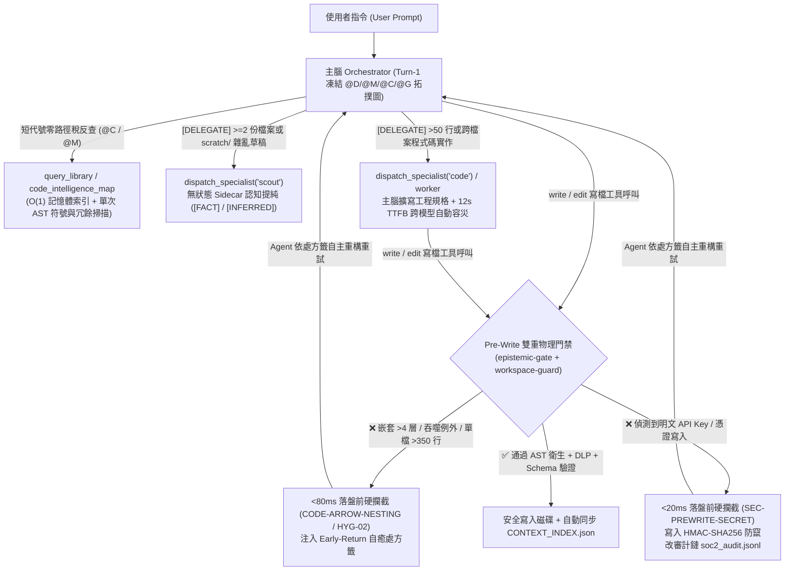

# ⚓ NetArk (`N.E.T.A.R.K.`) — Clean-Room V1 代理工程與認知治理核心

> **語言 / Language**: [English](README.md) | **繁體中文**

**N**etwork-shielded, **E**nforced-**T**emplate **A**rchival & **R**ule-indexed **K**ernel (`NetArk`) 是一套專為 **Pi Coding Agent**、**Google Antigravity (AGY)** 與 **Claude Code** 打造的可攜式雙層大腦、知識圖譜治理與零信任本地資安護欄核心。

---

## 🌟 四大核心架構支柱

1. **可攜式雙層大腦架構（`.netark/` + `memory/`）**
   - **執行期大腦（`.netark/`）**：內建漸進式記憶揭露、工作區資安門禁、多金鑰 Sticky Round-Robin 模型路由（`role-models.json`）與 5 大異質審查角色（`scout`、`architect`、`challenger`、`worker`、`auditor`）。
   - **受納管知識圖譜（`memory/`）**：以 5 個極簡純淨核心節點起點（`000_SOUL.md`、`100_ARCH_RULES.md`、`200_DECISIONS.md`、`LEDGER.md`、`HANDOVER.md`），由外部決定性驗證器（`schemas/schema_validator.py`）強制檢驗四級認知標籤與因果無環圖（DAG）。

2. **Turn-1 凍結 `@D/@M/@C/@G` 代號壓縮拓撲圖（~94% Token 壓縮率）**
   - 由 `scripts/auto_update_map.py` 自動掃描全專案記憶節點與程式碼 AST，編譯至 `memory/index/CONTEXT_INDEX.json`。
   - 開局 Turn 1 凍結注入目錄字典（`@D`）、記憶節點字典（`@M`）、腳本行號字典（`@C`）與三層 Dashboard 拓撲關係圖（`@G`：`[DAG]` 記憶因果邊、`[SYN]` 記憶管轄代碼突觸、`[AST]` 程式碼引用邊），100% 命中 Prefix KV Cache。
   - 支援 **L1-Full**（$\le 150$ 檔全圖）、**L2-Cluster**（$151\sim1,500$ 檔目錄叢集）與 **L3-ActiveCone**（$> 1,500$ 萬檔級活躍因果錐）三級自動縮放與 `query_library` 短代號反查。

3. **三層本地資安護欄與無對照檔單向脫敏（`G-01` ~ `G-05` 全面封口）**
   - **Tier 0（`schemas/netark_guard_core.py`）**：三階段結構化 AST 解析（`shlex` 引號接合、子 Shell 拆解、`python -c` 內嵌 `ast.parse`）、工作區物理邊界鎖定、控制面保護（`.netark/`、`.agents/`、`.claude/`、`schemas/`）、`*vault*.json` 與 `.env*` 絕對黑名單（`G-01`），以及寫檔前硬編碼私鑰防呆攔截（`SEC-PREWRITE-SECRET`，`G-02`/`G-04`）。
   - **Tier 1（`scripts/netark_guard_daemon.py`）**：本地 ONNX CPU 語意注入分類器（`Llama-Prompt-Guard-2-22M`），支援 0-VRAM 啟發式降級與本地開發工具 Fast-Path 免癱瘓通道。
   - **Tier 2**：可插拔內網語意守護模型插槽與 HMAC-SHA256 雜湊鏈簽章稽核日誌（`.netark/audit/soc2_audit.jsonl`）。

4. **獨立分離式專案控管中心（`dashboard/` — V1.1）**
   - 零外部依賴、支援單埠 HTTP/HTTPS 雙協定自動探測之視覺化戰情室（`python3 dashboard/backend/server.py 8765`），提供專案結構樹、四泳道節點關聯圖譜、工單與交接看板、以及程式碼行數水位監控（400 行預警 / 600 行防上帝腳本）。

---

## 🚀 快速開始

### 1. 一鍵初始化跨宿主轉接器與雙語記憶庫（`netark_init.py`）

```bash
# 為目標專案安裝 Pi / AGY / Claude 轉接器並建立繁體中文 5 核心記憶庫
python3 scripts/netark_init.py --target all --lang zh-TW --cwd /path/to/your-project

# 或使用英文母版初始化
python3 scripts/netark_init.py --target all --lang en --cwd /path/to/your-project

# 無損熱更新既有專案之護欄與擴充套件（完整保留既有 memory/ 記憶圖譜與 auth.json）
python3 scripts/netark_init.py --target all --cwd /path/to/your-project --update
```

### 2. 啟動 Pi Coding Agent

```bash
export PI_CODING_AGENT_DIR="$(pwd)/.netark"
cp .netark/auth.example.json .netark/auth.json
# 於 .netark/auth.json 填入 API Key，或進入 Pi 後輸入 /mode 設定多組逗號分隔金鑰
pi
```

### 3. 啟動視覺化專案控管中心 (`dashboard/`)

```bash
npm run dashboard
# 或直接以 Python 啟動：
python3 dashboard/backend/server.py 8765
```

---

## 🧪 全套決定性驗收測試指令

```bash
# 1. Tier 0 AST 與 G-01..G-05 資安封口自檢
python3 schemas/netark_guard_core.py --self-test

# 2. 跨宿主守護進程與寫檔防呆自檢
python3 scripts/netark_guard_daemon.py --self-test

# 3. @D/@M/@C/@G 壓縮拓撲編譯與 Schema Oracle 驗收
python3 scripts/auto_update_map.py --print-codebook
python3 schemas/schema_validator.py --run-oracle

# 4. Dashboard V1.1 契約測試
python3 dashboard/tests/test_dashboard_shards.py

# 5. NetArk 核心檢驗套件與 73+ 對抗樣本企業級護欄驗收
python3 scripts/test_netark_harness.py
python3 scripts/test_netark_enterprise_guard.py
```

---

## 🛡️ 實機執行期護欄攔截與專家分流實測展示 (Live Runtime Showcase)

NetArk 並非僅依賴 Prompt 軟性道德勸說，而是在任何工具觸碰磁碟前進行**毫秒級決定性物理攔截（Pre-Tool Deterministic Gates）**，並同步注入 `RemediationPointer` 自癒處方籤，讓 Agent 在不需人類介入下完成自主重構與容災切換。

### 執行期防禦與專家分流全鏈路架構圖



### 4 大核心場景實機攔截與自主修復軌跡

| 實測場景 | 觸發動作 | 執行期護欄 / 路由器真實反應 | 攔截延遲 | Agent 自主收斂結果 |
| :--- | :--- | :--- | :--- | :--- |
| **1. 零路徑稅短碼檢索與 AST 掃描** | 平行呼叫 `query_library("100")`、`query_library("C1")`、`code_intelligence_map(unused_only=true)` | 直接將 `@M` 前綴 `"100"` 解析為 `MEM-2026-0002`（`100.ARCH-RULES.v1`）、將 `@C` 短碼 `"C1"` 解析為 `schemas/netark_guard_core.py (L1-399)` 完整 AST 符號表，並精準揪出工作區內未使用的冗餘 import。 | `~400 ms` | 零次盲目 `grep`/`find` 探索，100% 保持 Turn-1 KV-Cache 命中。 |
| **2. Pre-Write AST 爛扣硬攔截與自癒** | 呼叫 `write("src/demo_hygiene.py")` 寫入 7 層 `if/for/try` 嵌套與 `except Exception: pass` | **落盤前物理阻斷**：`🛡️ [NetArk AST Code Hygiene Gate \| CODE-ARROW-NESTING]` 報錯嵌套深度 `7 > 4` 上限，並開出 Early-Return 重構處方籤。 | `79 ms` | Agent 於 **7.7 秒後**自動將函式重構為 Early-Return 扁平結構（嵌套降為 $\le 2$ 層、具名捕捉 `KeyError`）並一次通過寫入。 |
| **3. 主腦規格擴寫派工 + 12 秒跨模型自動容災** | 下達單句指令要求於 `src/discount_engine.py` 實作約 70 行階梯折扣與邊界驗證模組 | 主腦觸發 `@G [DELEGATE]` 鐵律（`>50` 行），自動將單句指令擴寫為 **7 點嚴格規格書**（強制 `Decimal` 精度、`Enum`、30% 封頂、區分 `TypeError`/`ValueError`）並派工 `specialist="code"`。首選模型發生 12 秒 TTFB Timeout $\rightarrow$ **Sticky Round-Robin 自動無縫切換備援模型**完成實作。 | `12.0 s` 自動切換 | 備援專家模型產出工業級 `Decimal` 防禦性元件，首次 `write` 即通過 AST 門禁。 |
| **4. Pre-Write 密鑰防洩漏攔截 + `scout` 情報提純** | 呼叫 `write("scratch/legacy_notes_a.md")` 建立含測試金鑰 `sk-legacy-a-<REDACTED>` 之模擬舊筆記並進行多檔盤點 | **落盤前物理阻斷**：`🛡️ [NetArk Guard \| SEC-PREWRITE-SECRET]` 瞬間攔截 `OPENAI_KEY` 特徵，同步寫入 HMAC-SHA256 雜湊鏈 `soc2_audit.jsonl`，並指示改用環境變數參照。 | `18 ms` | Agent 自動將明文金鑰替換為 `LEGACY_A_API_KEY` 環境變數說明後落盤，隨即觸發 `specialist="scout"` 提純出帶 `[FACT]` / `[INFERRED]` 標籤之跨文件衝突對照表。 |

<details>
<summary><b>🔍 點擊展開：Pre-Write AST 79ms 硬攔截與 Agent 自主重構前後實錄 (Test 2)</b></summary>

```python
# 1. Agent 第一次呼叫 write("src/demo_hygiene.py")（於 79ms 內被攔截，未寫入磁碟）：
def process_data(data):
    result = None
    if data is not None:
        if isinstance(data, dict):
            if "items" in data:
                if len(data["items"]) > 0:
                    for item in data["items"]:
                        if item.get("active"):
                            try:
                                result = item["value"]
                            except Exception:
                                pass
    return result
```

```text
🛡️ [NetArk AST Code Hygiene Gate | CODE-ARROW-NESTING]
[P1 CODE-ARROW-NESTING] Function 'process_data' in 'src/demo_hygiene.py' reaches control-flow nesting depth 7 (> 4 max allowed, line 1). Flatten using Early-Return guard clauses (`if not cond: return/continue`) or extract a helper.
```

```python
# 2. Agent 收到處方籤 7.7 秒後自主重構重試（嵌套深度降至 <= 2，順利通過門禁落盤）：
def process_data(data):
    if data is None or not isinstance(data, dict):
        return None
    items = data.get("items")
    if not items:
        return None
    for item in items:
        if not item.get("active"):
            continue
        try:
            return item["value"]
        except KeyError:
            continue
    return None
```
</details>

<details>
<summary><b>🔍 點擊展開：Pre-Write DLP 密鑰攔截、跨模型 Auto-Fallback 與專家產出代碼實錄 (Tests 3 & 4)</b></summary>

```text
🛡️ [NetArk Guard | SEC-PREWRITE-SECRET] 寫檔防呆攔截：偵測到嘗試將明文金鑰或憑證 (OPENAI_KEY) 直接寫入檔案 (scratch/legacy_notes_a.md)！
🔧 [RemediationPointer | 自癒處方籤]: 嚴禁將 API Key 硬編碼寫入源碼或設定檔！請將程式碼改寫為 `os.environ.get('KEY_NAME')` 或 `process.env.KEY_NAME`，並提示人類使用者自行於 `.env` 設定（嚴禁 Agent 讀寫 `.env`）。
```

```text
🤖 **[Specialist: code | Model: nvidia/nvidia/nemotron-3.5-lightning-30b-a3b]**
⚡ *[Auto-Fallback Triggered: nvidia/poolside/laguna-xs-2.1 (round 1/1): Request aborted [TTFB timeout (12s no first token)] -> Completed by nvidia/nvidia/nemotron-3.5-lightning-30b-a3b]*
```

```python
# 主腦將單句指令擴寫為 7 點規格後，由 'code' 專家模型產出之工業級元件 (src/discount_engine.py)：
from enum import Enum
from decimal import Decimal
from typing import Optional

class VIP_Level(Enum):
    BRONZE = Decimal("0")
    SILVER = Decimal("5")
    GOLD = Decimal("10")
    PLATINUM = Decimal("15")

def calculate_final_price(
    amount: Decimal,
    vip_level: VIP_Level,
    coupon_discount: Optional[Decimal] = None,
) -> Decimal:
    if not isinstance(amount, Decimal):
        raise TypeError("amount must be a Decimal")
    if amount < 0:
        raise ValueError("amount must be non-negative")
    if coupon_discount is not None and not isinstance(coupon_discount, Decimal):
        raise TypeError("coupon_discount must be a Decimal or None")
    ...
```
</details>

---

## ⚖️ 雙重授權條款 (License)

本專案採 **Prosperity Public License 3.0.0**（[LICENSE](LICENSE)）與 **NetArk 商業授權**（[COMMERCIAL-LICENSE.md](COMMERCIAL-LICENSE.md)）雙重授權；外部貢獻請參閱 [CLA.md](CLA.md)。
