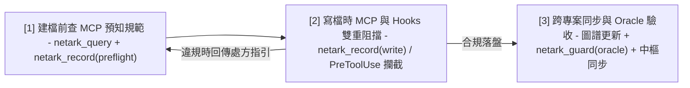

# ⚓ NetArk MCP (`netark-mcp`) — 零依賴跨宿主 CLI 與 MCP 部署手冊

> **定位**：本手冊說明如何透過 **`netark-mcp`**（`uv tool install netark-mcp`）在外部專案以 **0 `.py` 源碼落盤** 的方式啟用完整治理與記憶 MCP，涵蓋核心效益、三階段治理流程、AGY / Claude Code / Pi Agent 設定、三大 MCP 工具規格與阻斷處置指南。

---

## 🌟 1. 六大核心特點與實務效果

| # | 核心特點 | 對團隊與 AI Agent 的實務效果 |
| :-: | :--- | :--- |
| **1** | **零依賴全域 CLI 交付（目標專案 0 `.py` 落盤）** | 透過 `uv tool install netark-mcp` 全域安裝，目標專案**無須安裝治理源碼**即可啟用完整防護與記憶治理（選配 `NETARK-ENT-V1` 企業授權金鑰）。 |
| **2** | **Turn-1 壓縮圖譜與漸進式檢索** | 開局自動注入精簡代號圖譜與交接摘要，Agent 不需全倉盲搜即可精準定位規範與依賴關聯，穩定保留對話前綴快取。 |
| **3** | **寫入前雙重物理防呆攔截** | 在檔案落盤或指令執行前即時攔截硬編碼金鑰、敏感憑證讀取、未納管目錄寫入、過深控制流嵌套及殘缺子代理派工，並自動回傳修正指引。 |
| **4** | **建檔預檢 (`preflight`) 與自動編目** | 寫入記憶文件前可先呼叫預檢確認命名與格式合規；正式寫入時自動補齊結構標頭、校驗和與關聯索引，免除人工手寫報錯。 |
| **5** | **AGY / Claude 原生無侵入整合** | 直接透過宿主原生的生命週期 Hook 與標準 MCP 介面協同運作，不修改宿主工具本體即可保護原生檔案讀寫與終端指令。 |
| **6** | **跨專案記憶中樞與防竄改稽核** | 支援本機單倉或掛載中央記憶庫（`NETARK_MEMORY_ROOT`），將多專案決策、驗收狀態與稽核日誌集中納管、自動同步。 |

---

## 🔄 2. 系統運作流程（三階段閉環）



1. **階段一｜建檔前查 MCP 預知規範**：
   - Agent 開始規劃前透過宿主自動注入的圖譜摘要或呼叫 `netark_query` 掌握現有規格與依賴邊界。
   - 準備建立或更新記憶文件時，先以 `netark_record(..., mode="preflight")` 試算命名規範、必要欄位與長度上限，零風險取得修正建議。
2. **階段二｜寫檔時 MCP 與 Hooks 雙重阻擋**：
   - 受納管記憶文件統一經由 `netark_record(..., mode="write")` 原子寫入並更新索引；若 Agent 試圖使用宿主原生寫檔工具直接覆寫記憶目錄，宿主 Hook 會即時攔截並導流回 MCP。
   - 一般業務程式碼修改、終端命令與子代理派工繼續使用宿主原生工具，並由宿主 Hook 於執行前執行毫秒級安全與品質阻擋。
3. **階段三｜跨專案同步與 Oracle 驗收**：
   - 每次修改或對話結束時自動重整圖譜關聯與交接快照；透過 `netark_guard(action="oracle")` 執行獨立驗收確認全庫無斷鏈、無循環、無未驗證殘留，並於啟用中央記憶庫時同步至遠端（如 NAS 記憶中樞）。

---

## 🚀 3. 部署設定（AGY 與 Claude Code）

### 步驟 A：初始化目標專案與授權設定

```bash
# 方式一（公開跨平台主力）：透過 uv 全域安裝 CLI
uv tool install netark-mcp
cd /path/to/your-project
netark-mcp init --lang zh-TW --cwd .                  # 預設 --target memory：僅建 .mcp.json + memory/（不污染任何宿主目錄與 AGENTS.md/CLAUDE.md）
# 若同時要自動接好 AGY、Claude 或 Pi Hooks：
# netark-mcp init --target agy --lang zh-TW --cwd .    # 或 --target claude / --target pi；僅在需要根目錄範本時才加 --write-rules
# （純連 MCP 亦可於設定檔使用 command: "uvx", args: ["netark-mcp", "serve"]）

# 1. 選填：設定企業授權金鑰與中央記憶庫路徑（請勿硬編碼進專案檔案；未設定則以 community 模式運作）
export NETARK_LICENSE_KEY="NETARK-ENT-V1.<PAYLOAD>.<SIGNATURE>"
export NETARK_MEMORY_ROOT="/path/to/central-memory-hub"

# 2. 初始化目標專案（支援 memory[預設]、agy、claude、pi、all；已存在記憶檔、自訂 env 與同事件既有 Hook 均不覆蓋）
cd /path/to/your-project
netark-mcp init --target claude --lang zh-TW --cwd .
netark-mcp init --target agy --lang zh-TW --cwd .
netark-mcp init --target pi --lang zh-TW --cwd .

# 3. 若需卸載（只拆 NetArk Hook 與 MCP 接線，預設保留原專案設定與 memory/；加 --purge-memory 才清除記憶庫）
netark-mcp uninstall --target all --cwd .
```

> **安全提醒**：`NETARK_LICENSE_KEY` 屬於授權憑證，請透過本機 Shell 環境變數或宿主安全環境設定注入，切勿直接寫入專案 `.json` 並提交至版本控制。

### 步驟 B：Google Antigravity (AGY) 整合設定

1. **MCP Server 設定**（由 `netark-mcp init --target agy` 自動產生於 `.agents/plugins/netark/plugin.json` 與 `.agents/plugins/netark/mcp_config.json`，亦可改放全域 `~/.gemini/config/mcp_config.json`）：

```json
{
  "mcpServers": {
    "netark": {
      "command": "netark-mcp",
      "args": ["serve"],
      "env": {
        "NETARK_LICENSE_KEY": "${NETARK_LICENSE_KEY}",
        "NETARK_MEMORY_ROOT": "${NETARK_MEMORY_ROOT}"
      },
      "tools": {
        "netark_query": { "eager": true },
        "netark_record": { "eager": true },
        "netark_guard": { "eager": true }
      }
    }
  }
}
```

2. **AGY Lifecycle Hooks**（由 `netark-mcp init --target agy` 自動產生於 `.agents/hooks.json`）：

```json
{
  "netark-enterprise-guard": {
    "enabled": true,
    "SessionStart": [{ "type": "command", "command": "netark-mcp hook --session-start-mode agy --cwd .", "timeout": 5 }],
    "PreInvocation": [{ "type": "command", "command": "netark-mcp hook --pre-invocation-mode agy --cwd .", "timeout": 5 }],
    "PreToolUse": [{ "matcher": "read_file|view_file|write_file|edit_file|multiedit|write_to_file|replace_file_content|multi_replace_file_content|run_command|bash|invoke_subagent|Agent|Task|search_web|web_fetch", "hooks": [{ "type": "command", "command": "netark-mcp hook --hook-mode agy --cwd .", "timeout": 5 }] }],
    "PostToolUse": [{ "matcher": "write_file|edit_file|multiedit|write_to_file|replace_file_content|multi_replace_file_content", "hooks": [{ "type": "command", "command": "netark-mcp hook --post-hook-mode agy --cwd .", "timeout": 10 }] }],
    "Stop": [{ "type": "command", "command": "netark-mcp hook --stop-mode agy --cwd .", "timeout": 10 }]
  }
}
```

### 步驟 C：Claude Code 整合設定

1. **專案 MCP 設定**（`.mcp.json`）：

```json
{
  "mcpServers": {
    "netark": {
      "command": "netark-mcp",
      "args": ["serve"],
      "env": {
        "NETARK_LICENSE_KEY": "${NETARK_LICENSE_KEY}",
        "NETARK_MEMORY_ROOT": "${NETARK_MEMORY_ROOT}"
      },
      "tools": {
        "netark_query": { "eager": true },
        "netark_record": { "eager": true },
        "netark_guard": { "eager": true }
      }
    }
  }
}
```

2. **Claude Code Hooks**（由 `netark-mcp init --target claude` 自動寫入 `.claude/settings.json`）：

```json
{
  "hooks": {
    "SessionStart": [{ "matcher": "", "hooks": [{ "type": "command", "command": "netark-mcp hook --session-start-mode claude --cwd ." }] }],
    "PreToolUse": [{ "matcher": "Bash|Write|Edit|MultiEdit|Read|Task|Agent|WebFetch", "hooks": [{ "type": "command", "command": "netark-mcp hook --hook-mode claude --cwd ." }] }],
    "PostToolUse": [{ "matcher": "Write|Edit|MultiEdit", "hooks": [{ "type": "command", "command": "netark-mcp hook --post-hook-mode claude --cwd ." }] }],
    "Stop": [{ "matcher": "", "hooks": [{ "type": "command", "command": "netark-mcp hook --stop-mode claude --cwd ." }] }]
  }
}
```

---

## 🧰 4. MCP 工具介面參考（3 大高內聚工具）

| 工具名稱 | 關鍵輸入參數 | 回傳內容與用途說明 |
| :--- | :--- | :--- |
| **`netark_query`** | `query`（短代號／節點鍵／狀態／主題／關鍵字）、`project_id`（選填專案識別） | 查詢記憶節點摘要、受管檔案與程式碼關聯鄰居（1-hop 依賴與影響範圍），免去全文掃描。 |
| **`netark_record`** | `intent`（`wiki` \| `note` \| `sop` \| `glossary` \| `blueprint` \| `spec` \| `audit` \| `handover`）、`title`、`body`、`mode`（`preflight` \| `write`）、選填：`target_path`（原地更新既有記憶檔）、`domain_code`、`slug`、`topic`、`parent_blueprint`、`shard_modules`、`stub_paths`、`scope_profile`、`supersedes`、`relates_to`、`affected_paths` | **`preflight`**：只檢不寫，檢查命名、標頭完整性、可攜性、行數預算、防跳步與 `SPEC-AST-SYNC-GATE`；**`write`**：自動鎖定合法目錄（或依 `target_path` 原地更新），補齊治理標頭與索引更新並完成驗證。 |
| **`netark_guard`** | `action`（`status` \| `oracle` \| `handover` \| `setup`） | **`status`**：檢視授權、防護策略與稽核鏈健康度；**`oracle`**：執行全記憶庫 Schema＋拓撲無環驗收；**`handover`**：檢查各軌道交接與台帳狀態；**`setup`**：按需回傳通用 Hook CLI 契約（`HOOK_CONTRACT.md`）供任意宿主自行串接。 |

---

## 🛠️ 5. 常見阻斷碼與標準處置對照表（均自動附帶 `[RuleDoc]` 與 `[SuggestedAlternative]` 處方籤）

| 阻斷碼 | 觸發原因 | 建議處置動作 |
| :--- | :--- | :--- |
| **`SIDECAR-GATE`** | 對 `> 600` 行大型檔案未指定範圍硬讀、連續切香腸超過上限或使用 `cat`/`sed`/`awk`/大行數 `head`/`tail`（`> 120` 行）/`python -c` 傾印繞過 | 改依 `CONTEXT_MAP.md` 行號做 `<= 600` 行局部讀取、`<= 120` 行 `head`/`tail`，或派發 `research` / `Explore` 唯讀子代理（自動取得租約配額）消化。 |
| **`SPEC-AST-SYNC-GATE`** | 撰寫 `spec` 時綁定之 `affected_paths`/`stub_paths` 既有程式碼，內文未對齊任何 AST 符號且未標註「新增」 | 依阻斷訊息印出之實際 AST 符號清單對齊真實函式／類別名稱，或於內文標註 `新增` / `stub`。 |
| **`SEC-CRED`** | 試圖讀取或修改受保護之機密憑證檔案（如 `.env*`、金鑰、憑證設定） | 停止存取該檔案；請人類開發者手動設定本機環境變數，程式改用環境變數讀取。 |
| **`SEC-PREWRITE-SECRET`** | 寫入內容包含明文 API Key、私鑰或機密連線字串 | 移除硬編碼字串，改以環境變數介面讀取後重新寫入。 |
| **`SEC-CONTROL-PLANE`** | 試圖修改受保護之治理控制面目錄或設定檔 | 確認是否為預期維護操作；於互動確認提示核准後再執行，勿繞過保護目錄。 |
| **`SEC-CODE-PLACEMENT`** | 程式碼寫入專案根目錄、未核准目錄或暫存區檔名未帶測試前綴 | 將業務程式移至規範之專案子目錄，或將臨時測試檔命名為 `test_*` 置於暫存區。 |
| **`SEC-SSRF` / `SEC-XPIA-WEB` / `SEC-WEB-SECRET-QUERY`** | 網路請求指向內網保留位址、非 HTTP/HTTPS 協定或網址夾帶機敏參數／注入特徵 | 確認僅存取合法公開 HTTPS/HTTP 端點，並清除查詢參數中的機敏權杖。 |
| **`CODE-ARROW-NESTING` / `CODE-SILENT-EXCEPT` / `CODE-NESTED-LOOPS` / `CODE-GOD-FUNCTION` / `MODULARITY-GATE`** | 程式碼控制流過深、靜默吞掉例外、迴圈過深或單一函式／檔案過長 | 改採 Early-Return 扁平結構、具名捕捉例外，並依職責拆分為較小函式或獨立模組。 |
| **`SPEC-RIBC-GATE`** | 派工給實作型子代理時缺少完整四維任務規格或說明過短 | 補齊 `[R]` 職責路徑、`[I]` 不變量與行數上限、`[B]` 邊界防護、`[C]` 型別契約且達規定字數後重派。 |
| **`SPEC-FILENAME-FORMAT` / `SCHEMA-403-PREFILL`** | 記憶文件命名不符規範、序號重複，或直接寫入缺標頭之受管記憶檔 | 依建議序號更名，並改用 `netark_record`（先 `preflight` 再 `write`）完成建檔。 |
| **`MCP-PROB-01-REDIRECT`** | `NETARK_MCP_HOOK_MODE=1` 下試圖用原生 `write_file`/`Write` 新建或整檔覆寫 `memory/**/*.md`（排除 `CONTEXT_MAP.md`；已存在檔之 `edit_file`/`Edit` 放行並自動後檢） | 改呼叫 MCP `netark_record`（`preflight` ➔ `write`，或傳入 `target_path` 原地更新）寫入記憶節點，或使用 `edit_file` 局部編修既有記憶檔。 |
| **`SPEC-BLUEPRINT-REQUIRED` / `STUB-FIRST-GATE`** | 複合型 `spec` 缺少 `parent_blueprint`，或未經 `stub_ready`/`verified` 規格授權即新建／大改受管 `.py` 模組 | 先透過 `netark_record` 建立或推進對應母藍圖與切片至 `stub_ready`，再動工程式碼。 |
| **`SEC-HANDOVER-OVERWRITE`** | 試圖直接以不同任務覆寫尚未結案的交接檔案 | 若為新支線請另建獨立軌道交接檔；若確定切換任務，請先結案舊軌或確認覆寫。 |
