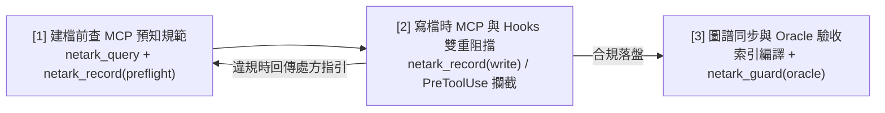

# ⚓ NetArk (`netark-mcp`) — 使用與部署手冊

> **定位**：本手冊說明如何使用 **`netark-mcp`**（純 Python 3.10+ 標準庫封裝）快速啟用核心防護與可攜式 Markdown 記憶治理，涵蓋三階段閉環、AGY / Claude Code 設定、三大 MCP 工具與常見阻斷碼處置。

---

## 🌟 1. 六大核心特點與實務效果

| # | 核心特點 | 對團隊與 AI Agent 的實務效果 |
| :-: | :--- | :--- |
| **1** | **零外部依賴與零 `.py` 污染** | 透過 `uv tool install netark-mcp` 或 `uvx` 執行，目標業務專案**不需複製任何治理 `.py` 源碼**即可啟用完整防護。 |
| **2** | **Turn-1 壓縮圖譜與漸進式檢索** | 開局自動注入精簡 `@D/@M/@C/@G` 代號圖譜與交接摘要，Agent 不需全倉盲搜即可精準定位規範與依賴關聯。 |
| **3** | **寫入前雙重物理防呆攔截** | 在檔案落盤或指令執行前即時攔截硬編碼金鑰、敏感憑證讀取、未納管目錄寫入、過深控制流嵌套及殘缺子代理派工。 |
| **4** | **建檔預檢 (`preflight`) 與自動編目** | 寫入記憶文件前先呼叫預檢確認命名與格式；正式寫入時自動補齊結構標頭、校驗和與關聯索引。 |
| **5** | **AGY / Claude 原生非破壞性整合** | 直接透過宿主原生 Hook 與標準 MCP 介面協同運作，既有環境設定、其他 MCP Server 與記憶檔均完整保留。 |
| **6** | **中央記憶庫與完整拓撲驗收** | 支援本機單倉或掛載共享記憶庫（`NETARK_MEMORY_ROOT`），並以 `netark_guard(action="oracle")` 驗證全庫無斷鏈、無循環。 |

---

## 🔄 2. 系統運作流程（三階段閉環）



---

## 🚀 3. 部署設定（`uv` / `uvx` + AGY / Claude Code）

### 步驟 A：安裝與初始化目標專案

```bash
# 1. 安裝標準套件（或使用 uvx netark-mcp serve 免安裝執行 MCP）
uv tool install netark-mcp

# 2. 初始化目標專案（預設 --target memory：僅建 .mcp.json + memory/，不污染宿主目錄與 AGENTS.md/CLAUDE.md）
cd /path/to/your-project
netark-mcp init --lang zh-TW --cwd .

# 若同時要自動接好 AGY 或 Claude Hooks：
# netark-mcp init --target agy --lang zh-TW --cwd .
# netark-mcp init --target claude --lang zh-TW --cwd .
# （僅在需要根目錄範本時才額外加上 --write-rules）

# 3. 選填：若需掛載共享記憶根目錄
export NETARK_MEMORY_ROOT="/path/to/shared-memory-root"

# 4. 卸載接線（預設保留既有 memory/；加 --purge-memory 才清除記憶庫）
netark-mcp uninstall --target all --cwd .
```

### 步驟 B：Google Antigravity (AGY) 整合設定

由 `netark-mcp init --target agy` 自動產生 `.agents/plugins/netark/mcp_config.json` 與 `.agents/hooks.json`：

```json
{
  "mcpServers": {
    "netark": {
      "command": "netark-mcp",
      "args": ["serve"]
    }
  }
}
```

### 步驟 C：Claude Code 整合設定

由 `netark-mcp init --target claude` 自動合併 `.mcp.json` 與 `.claude/settings.json`：

```json
{
  "hooks": {
    "SessionStart": [{ "matcher": "", "hooks": [{ "type": "command", "command": "netark-mcp hook --session-start-mode claude --cwd ." }] }],
    "PreToolUse": [{ "matcher": "Bash|Write|Edit|MultiEdit|Read|Task|Agent|WebFetch", "hooks": [{ "type": "command", "command": "netark-mcp hook --hook-mode claude --cwd ." }] }],
    "PostToolUse": [{ "matcher": "Write|Edit|MultiEdit", "hooks": [{ "type": "command", "command": "netark-mcp hook --post-hook-mode claude --cwd ." }] }],
    "Stop": [{ "matcher": "", "hooks": [{ "type": "command", "command": "netark-mcp hook --stop-mode claude --cwd ." }] }]
  }
}
```

---

## 🧰 4. MCP 工具介面參考（3 大高內聚工具）

| 工具名稱 | 關鍵輸入參數 | 回傳內容與用途說明 |
| :--- | :--- | :--- |
| **`netark_query`** | `query`（短代號／節點鍵／狀態／主題／關鍵字）、`project_id`（選填專案識別） | 查詢記憶節點摘要、受管檔案與程式碼關聯鄰居（1-hop 依賴與影響範圍），免去全文掃描。 |
| **`netark_record`** | `intent`（`wiki` \| `note` \| `sop` \| `glossary` \| `blueprint` \| `spec` \| `audit` \| `handover`）、`title`、`body`、`mode`（`preflight` \| `write`）及選填拓撲欄位 | **`preflight`**：只檢不寫，檢查命名、標頭、可攜性、行數預算、防跳步與 `SPEC-AST-SYNC-GATE`；**`write`**：原子落盤並更新索引。 |
| **`netark_guard`** | `action`（`status` \| `oracle` \| `handover` \| `setup`） | **`status`**：檢視防護策略健康度；**`oracle`**：全記憶庫 Schema＋拓撲無環驗收；**`handover`**：檢查各軌道交接狀態；**`setup`**：回傳通用 Hook CLI 契約（`HOOK_CONTRACT.md`）。 |

---

## 🛠️ 5. 常見阻斷碼與標準處置對照表

| 阻斷碼 | 觸發原因 | 建議處置動作 |
| :--- | :--- | :--- |
| **`SIDECAR-GATE`** | 對 `> 300` 行檔案未指定範圍硬讀、連續切香腸超過上限或用 `cat`/`head`/`sed` 傾印繞過 | 改依 `CONTEXT_MAP.md` 行號做 `<= 300` 行局部讀取，或派發唯讀研究子代理消化。 |
| **`SPEC-AST-SYNC-GATE`** | 撰寫 `spec` 時綁定之 `affected_paths`/`stub_paths` 既有程式碼，內文未對齊真實 AST 符號且未標註新增 | 依阻斷訊息印出之實際 AST 符號清單對齊真實名稱，或於內文標註 `新增` / `stub`。 |
| **`SEC-CRED`** | 試圖讀取或修改 `.env*`、`auth.json`、`*vault*.json` 等憑證檔案 | 停止存取該檔案；請人類開發者手動設定環境變數並改用 `os.environ.get(...)`。 |
| **`SEC-PREWRITE-SECRET`** | 寫入內容包含明文 API Key、私鑰或機密連線字串 | 移除硬編碼字串，改由環境變數介面讀取後重新寫入。 |
| **`SEC-CONTROL-PLANE`** | 試圖修改受保護之治理控制面目錄（`.agents/`、`.claude/`、`schemas/` 等） | 確認為預期維護操作並等待人工確認提示核准後再執行。 |
| **`SEC-CODE-PLACEMENT`** | 程式碼寫入專案根目錄、未核准目錄或暫存區檔名未帶測試前綴 | 將業務程式移至規範之專案子目錄，或將臨時測試檔命名為 `test_*` 置於 `scratch/`。 |
| **`CODE-ARROW-NESTING` / `CODE-SILENT-EXCEPT` / `MODULARITY-GATE`** | 控制流嵌套過深、靜默 `except: pass` 或檔案／函式超過行數上限 | 改採 Early-Return 扁平結構、具名捕捉例外並依職責拆分為較小模組。 |
| **`SPEC-RIBC-GATE`** | 派工給實作型子代理時缺少完整 `[R]/[I]/[B]/[C]` 規格或長度不足 60 字元 | 補齊職責路徑、不變量、邊界與型別契約後重派。 |
| **`MCP-PROB-01-REDIRECT`** | Hook 模式下試圖直接以原生工具覆寫 `memory/**/*.md` | 改呼叫 MCP `netark_record`（`preflight` ➔ `write`）寫入記憶節點。 |
| **`SPEC-BLUEPRINT-REQUIRED` / `STUB-FIRST-GATE`** | 複合 `spec` 缺少 `parent_blueprint`，或未經 `stub_ready`/`verified` 規格授權即新建／大改受管模組 | 先透過 `netark_record` 將對應母藍圖與切片推進至 `stub_ready`，再動工程式碼。 |
| **`SEC-HANDOVER-OVERWRITE`** | 試圖直接覆寫尚未結案的交接檔案 | 為新支線另建獨立 `HANDOVER_<TRACK>.md`，或先結案舊軌再覆寫。 |
